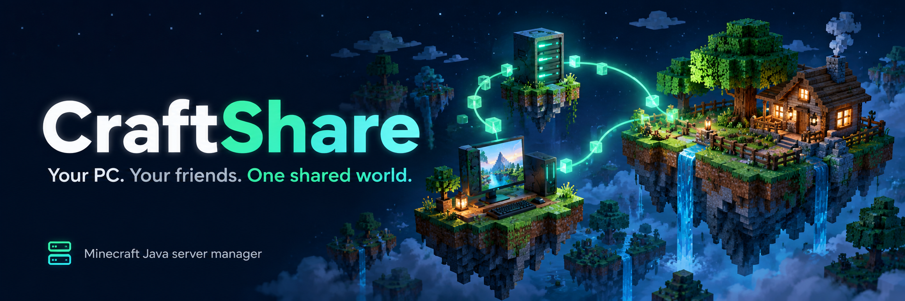
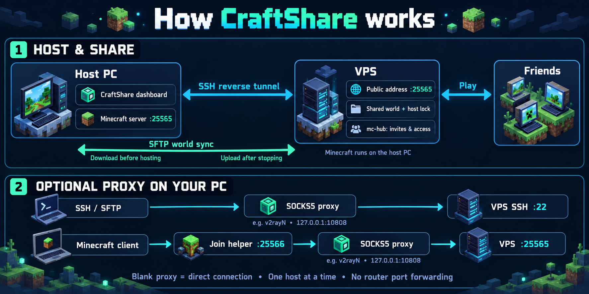

# CraftShare: host a Minecraft server from your PC without port forwarding

[](https://github.com/iamhelitha/craftshare/releases/latest)
[](https://github.com/iamhelitha/craftshare/releases)
[](https://github.com/iamhelitha/craftshare/actions/workflows/ci.yml)
[](LICENSE)

**CraftShare** is a free, open-source **Minecraft Java server manager for Windows**. Host a vanilla Minecraft
server on your own PC, let friends join through a cheap VPS (no router port forwarding, works behind CGNAT and
mobile data), and **share one world** so anyone in your group can host when they want: one at a time, always
with the latest progress. Everything runs from a simple web dashboard; no command line needed.

- **Friendly web page**: start/stop, players and admins, world settings, backups, console. No terminal.
- **No port forwarding**: an SSH reverse tunnel publishes the server on your VPS (`VPS:25565`).
- **Shared world**: kept on the VPS. Whoever hosts downloads the latest copy and uploads it when done. A lock
  stops two people hosting at once.
- **Invites, not shared passwords**: each PC makes its own key; the owner sends a single-use invite code.
- **No installs for friends**: one `.exe`; Minecraft and Java download automatically.
- Light on the VPS (about 20 MB of RAM) and does not touch other software such as 3x-ui/Xray.

## How it works



Minecraft runs on the **host PC**. Friends connect to **`VPS:25565`**, and the VPS forwards their traffic
through the SSH reverse tunnel. The app downloads a newer shared world before hosting and uploads the saved
world after stopping; a VPS lock lets one person host at a time.

For a connection that needs a proxy, set **Setup > Network/proxy** to your local SOCKS5 endpoint
(for example, v2rayN at `127.0.0.1:10808`). SSH and SFTP then use that proxy. To play through it, connect
Minecraft to **`localhost:25566`**: the app's join helper routes that connection through SOCKS5 to the VPS.
Leave the proxy blank for a direct connection. Ports shown in the diagram are the defaults.

## Download

Get `MinecraftManager.exe` (or the zip) from the [latest release](../../releases/latest).
Put it in its own folder and double-click it. Your browser opens the manager at `http://127.0.0.1:8765`
(this PC only). Close the black window or press **Shut down** to stop: the world is saved, backed up and
uploaded first.

## Owner: set up your VPS (once)

Log in to your Linux VPS as root and run:

```bash
bash <(curl -Ls https://raw.githubusercontent.com/iamhelitha/craftshare/main/install.sh)
```

It asks before changing the firewall, then prints an **owner code**. In the app open **Setup > Friends & access >
I own the VPS** and paste it. If your provider has a firewall panel, open TCP **25565** and **8766** there.

Later, on the VPS, type **`mc-hub`** to see who is hosting, your friends, the shared world and blocked IPs.
`mc-hub update` updates safely (checksum-verified, rolls back on failure) and `mc-hub uninstall` removes
everything after offering a backup download. Details: [docs/vps-setup.md](docs/vps-setup.md).

## Friends: join

1. The owner presses **Invite a friend** and sends you the code.
2. Open the app, type your name in **Setup**, paste the code under **Join a server**, press **Join**.
3. Go to **Home** and press **Start server** to host, or just join the address shown there in Minecraft.

## Updates

The app checks GitHub for new releases. When one is out, Home shows a banner and **Setup > App updates** has an
**Update** button. The update is downloaded from the official release, checked against its published SHA-256,
test-started, and only then swapped in; the app restarts by itself in a new window. Your world, settings and
backups are not touched, and updates install only while the server is stopped. If the new version cannot start,
the previous one is put back automatically, and **Go back** returns to it any time.

The VPS side updates with `mc-hub update`. The owner can require a minimum app version for hosting with
`mc-hub require-app 0.4.0`, so nobody hosts the shared world with an outdated app.

## The pages

- **Home**: start/stop hosting, who is hosting, the address to join, players online.
- **Players**: make admins, change game mode, heal, kick, ban, whitelist.
- **World settings**: game mode, difficulty, PvP, whitelist, cracked players and more.
- **Backups**: automatic at every start, with limits so they do not fill your disk. Restore or drop in any world `.zip`.
- **Console**: server log, commands, chat.
- **Setup**: your name, Minecraft version, memory, Java, network/proxy, friends and access.

## Run from source

```bat
start.bat
```

Needs Python 3.11+. Developer notes: [CONTRIBUTING.md](CONTRIBUTING.md), [docs/architecture.md](docs/architecture.md).

## Repository layout

```
apps/manager/   the Windows app (aiohttp backend + web/index.html)
apps/hub/       mc-hub, the VPS service for invites
install.sh      one-line VPS installer
docs/           setup and architecture notes
```

## FAQ

**How do I host a Minecraft server without port forwarding?**
CraftShare opens an SSH reverse tunnel from your PC to a VPS you rent (1 GB RAM is enough; the VPS does not run
Minecraft). Friends connect to the VPS address and the traffic is passed to your PC. This also works when your
ISP uses CGNAT or you are on mobile data.

**Can my friends and I take turns hosting the same world?**
Yes. The world is stored on the VPS. When you start hosting, CraftShare downloads the latest copy; when you stop,
it uploads it. A lock with a heartbeat makes sure only one person hosts at a time.

**Do I need to install Java or Python?**
No. Download the `.exe`. The Minecraft server jar and the right Java version download automatically.

**Which Minecraft versions work?**
Any vanilla Java Edition release from Mojang's official list, chosen in Setup. Everyone must join with the same version.

**Does it work with cracked / TLauncher players?**
The server runs with `online-mode=false` so offline launchers can join. Turn on the whitelist if strangers might find your address.

**Is it safe to use on a VPS that already runs other things (for example 3x-ui / Xray)?**
Yes. The installer only adds two locked-down accounts and a small service, and does not touch other software.

**Where are backups kept?**
On your PC (automatic at every start, with a size limit) and the last few world versions on the VPS. You can
restore or import any world `.zip` from the Backups page.

## License

[GPL-3.0](LICENSE). Not affiliated with Mojang or Microsoft.
